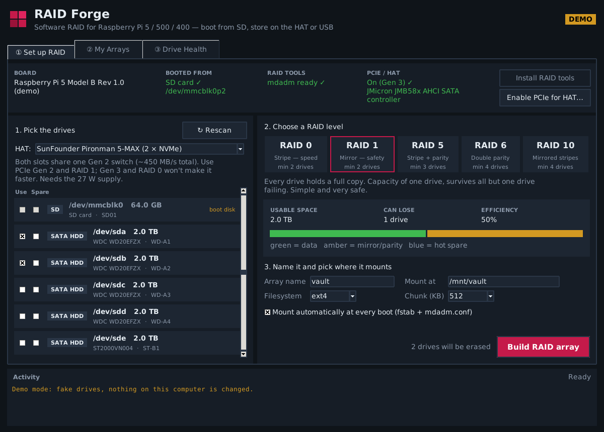
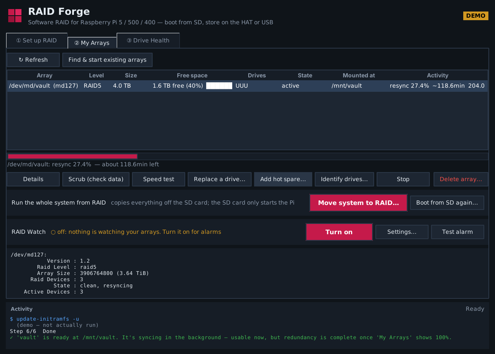
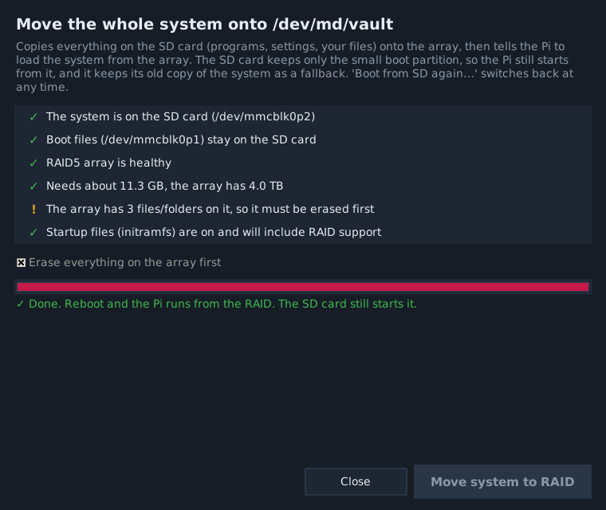
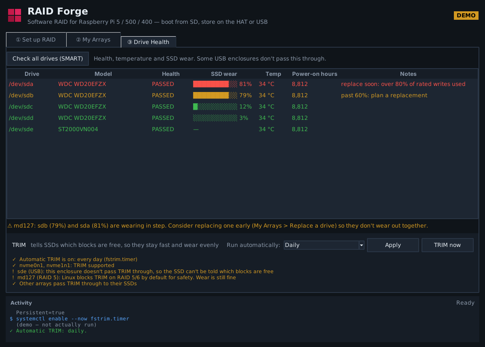
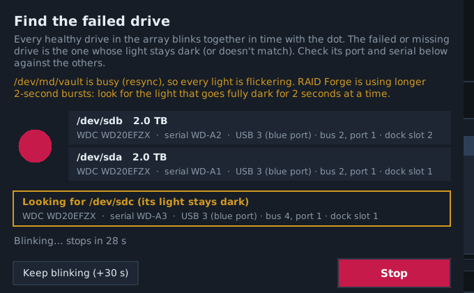
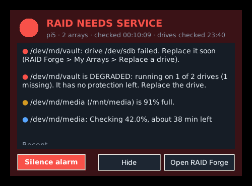
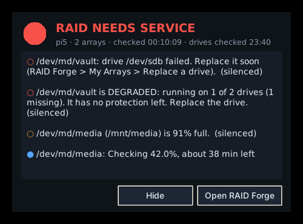
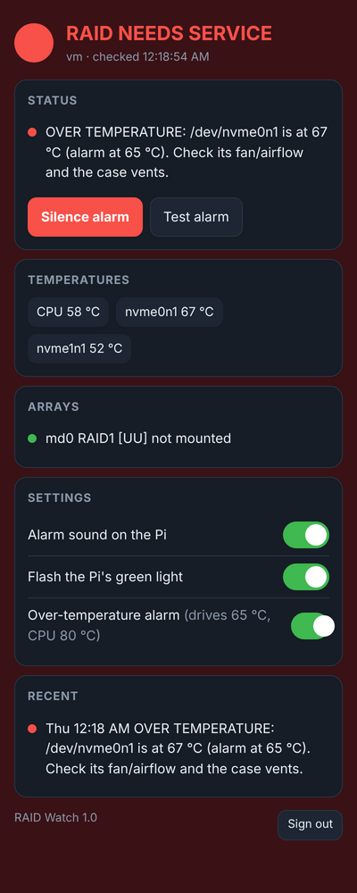
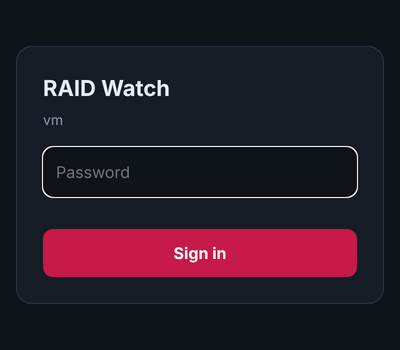

# RAID Forge

Point-and-click software RAID for the Raspberry Pi 5, Pi 500 and Pi 400. Boot Pi OS from the SD card,
put your drives on a HAT, and build a RAID 0, 1, 5, 6 or 10 array without touching the terminal.



| | |
|:---:|:---:|
|  |  |
| **My Arrays**: live rebuild progress, drive swaps, scrubs | **Move system to RAID**: the SD card only starts the Pi |

## Install
```bash
git clone https://github.com/hardwaremack-prog/raidforge
cd raidforge
bash install.sh
```
Or download the zip, unzip it and run `bash install.sh` inside the `raidforge` folder.

Then open **Menu → System Tools → RAID Forge**. Use **RAID Forge (Demo)** first to try it with fake drives.

## What it does
**① Set up RAID**
- Checks the board, confirms you booted from the SD card, and that `mdadm` is installed (one-click install if not)
- Enables the Pi 5 PCIe connector for SATA/NVMe HATs (Gen 2 or Gen 3), backs up `config.txt`, offers a reboot
- Lists every drive with type (SATA/NVMe/USB), size and model; the SD boot card and in-use drives are locked out
- Pick RAID 0/1/5/6/10, tick drives, optionally tick hot spares — shows usable space, how many drives you can lose, and efficiency live
- Name it, choose a mount folder, ext4 or XFS, chunk size, and whether it auto-mounts at boot
- Type `ERASE` to confirm → wipes, creates the array, formats (stripe-aligned), mounts, writes `mdadm.conf` + `fstab` (`nofail`, so the Pi still boots if the HAT is unplugged), updates initramfs

**② My Arrays** — live status every 3 s with **free space** (amber under 10%, red under 2%), sync/rebuild progress, details, scrub, speed test, replace a failed drive, add a hot spare, stop, re-assemble, delete (also cleans up fstab/mdadm.conf)

**Move system to RAID** (on My Arrays) — runs the whole system from the array; the SD card only starts the Pi
- Checks first: system is on the SD card, array is healthy and big enough, startup files (initramfs) can find RAID
- Copies everything from the SD card onto the array with live progress (rsync), erasing the array first if needed
- Points the new copy's `fstab` at the array, adds the RAID/USB/NVMe/SATA drivers to the initramfs and rebuilds it
- Backs up `cmdline.txt` as `cmdline.txt.raidforge-sd`, then sets `root=` to the array and asks to reboot
- The SD card keeps its boot partition and its old copy of the system as a fallback
- **Boot from SD again…** puts the original `cmdline.txt` back. If the Pi ever won't start, put the SD card in another
  computer and copy `cmdline.txt.raidforge-sd` over `cmdline.txt` (see `RAID-FORGE-README.txt` on the card)
- Use RAID 1 (or 5/6/10) for this: on RAID 0 one dead drive takes the whole system with it
- **Low-wear** option: moves swap from a file on the drives into compressed RAM (zram)

**③ Drive Health**: SMART pass/fail, temperature, power-on hours, bad sectors, and **SSD wear** (NVMe and SATA SSDs),
with warnings at 60% / 80% and a flag for mirror pairs wearing in step. Its **TRIM** panel runs TRIM weekly
(recommended), daily or not at all, has a **TRIM now** button, and shows which drives, USB enclosures and arrays support it.



**Finding a drive (Identify / Blink)**: with a row of identical USB drives, RAID Forge can blink one drive's
activity light. It reads from just that drive in a slow on/off rhythm, read-only and safe on a live array, and shows
which **USB port** (USB 3 or 2, hub port, dock slot), **SATA port** or **NVMe slot** it's on, plus its **serial number**.
- **Blink** button on every drive (Set up RAID), **Identify drives…** (My Arrays), **Blink selected drive** (Drive Health)
- **Find the failed drive**: blinks all the healthy drives together, so the dead one is the light that stays dark
- **Replace a drive…** offers to do that first, so you pull the right one
- If an array is busy (resync), it uses longer 2-second bursts that stand out from normal flicker



**RAID Watch** (the alarm): a small watchdog that keeps an eye on every array and sounds the alarm when one needs service.
Turn it on in **My Arrays → RAID Watch → Turn on**. It runs in the background from boot (even with no screen), and its little
window opens when you log in, then hides itself while everything is healthy.

| | |
|:---:|:---:|
|  |  |
| **Alarm**: window flashes red, alarm sound, desktop pop-up | **Silenced**: quiet, but still shows what's wrong |

| Level | What triggers it | What happens |
|---|---|---|
| 🔴 Critical | drive failed, array degraded, array stopped, array didn't start, SMART says FAILING, 98%+ full | window flashes + alarm sound every 5 s, pop-up, Pi's green light flashes fast, phone push |
| 🟠 Warning | rebuild running on a degraded array, SSD wear 80%+, new bad sectors, drive over 60 °C, 90%+ full, data-check mismatches, hot spare used up | pop-up, amber window, phone push |
| 🔵 Info | rebuild / sync / check in progress (with % and time left) | shown in the window |
| 🟢 OK | everything healthy | "back to normal" pop-up and phone push after a problem |

- **Silence alarm** stops the sound and light. If it's still broken 4 hours later (or 1/12/24, your choice), it alarms again.
- **Test alarm** (My Arrays) raises a pretend alarm for a minute, so you can check the sound, the light and your phone.
- **Phone alerts (optional)**: install the free **ntfy** app, press **Settings… → Make one** for a private topic name and
  subscribe to it in the app. You get one push when something breaks and one when it's fixed.
- Checks arrays every 15 s and drive SMART every 6 h. Status is in `/run/raidwatch/status.json`, and the history is in
  `journalctl -u raidwatch`. Over SSH, `sudo python3 /opt/raidforge/raidwatch.py --once` prints the current state.
- Try the window with a pretend failed drive: `python3 raidwatch.py --demo`

**Over-temperature alarm (optional)**: in **Settings…**, tick *Sound the alarm if a drive or the Pi gets too hot*. RAID Watch
then reads drive temperatures (and the Pi's processor) every 2 minutes. It **warns 5 °C before** the limit and **alarms at it**
(defaults: drives 65 °C, Pi 80 °C; the Pi slows itself down at 85 °C). It doesn't flip-flop when sitting right at the limit, and
a silenced warning alarms again if it gets worse.

**Web page with a password (optional)**: tick *Show RAID Watch on a web page* in **Settings…**, choose a password (8+ characters)
and open `http://<your-pi>:8484` from your phone or PC on the home network. It shows the status, temperatures, arrays and
recent events, with **Silence alarm**, **Test alarm** and switches for the alarm sound, the green light and the
over-temperature alarm.

| | |
|:---:|:---:|
|  |  |

- The password is stored only as a salted PBKDF2 hash, in `/etc/raidwatch.json`, which only admin can read.
- Five wrong passwords lock that device out for 5 minutes. Sessions last 12 hours, and **Sign out** ends them.
- Cookies are `HttpOnly` + `SameSite=Strict`, every button needs a per-session token, and the page can't be framed
  by other sites.
- It's plain HTTP, meant for your **home network only**. Don't forward its port to the internet. Use a VPN
  (Tailscale / WireGuard) to check it from away.

## Hardware notes
| Setup | Notes |
|---|---|
| Pi 5 + Radxa Penta SATA HAT | Up to 5 SATA drives. Needs PCIe enabled and the HAT's own 12 V supply. |
| Pi 5 + dual/quad NVMe HAT (PCIe switch) | Use PCIe Gen 2. 2 drives → RAID 0/1; 4 drives → any level. |
| Pi 500 | No PCIe connector is exposed, so use USB 3 drives, a USB multi-bay dock or USB HAT. Use powered enclosures. |
| Pi 400 | Same as the Pi 500: no PCIe, so use the two blue USB 3 ports with powered drives or a multi-bay dock. Slower (USB 3 is shared), but RAID 1 / 5 work well. |
| Pi 500+ | Has one internal M.2 slot — add USB drives to reach RAID levels that need more. |
| Pi 5 + SunFounder Pironman 5-MAX | 2 NVMe slots behind a Gen 2 switch: RAID 1, PCIe Gen 2, ~410–450 MB/s. |

Minimum drives: RAID 0 / 1 → 2, RAID 5 → 3, RAID 6 / 10 → 4 (RAID 10 even numbers only).

**📈 Speeds, Gen 2 vs Gen 3, "does RAID 1 double reads?", SSD wear and TRIM, and recommended setups: see [SPEED-GUIDE.md](SPEED-GUIDE.md).**

RAID is not a backup — keep a copy of anything important somewhere else.
